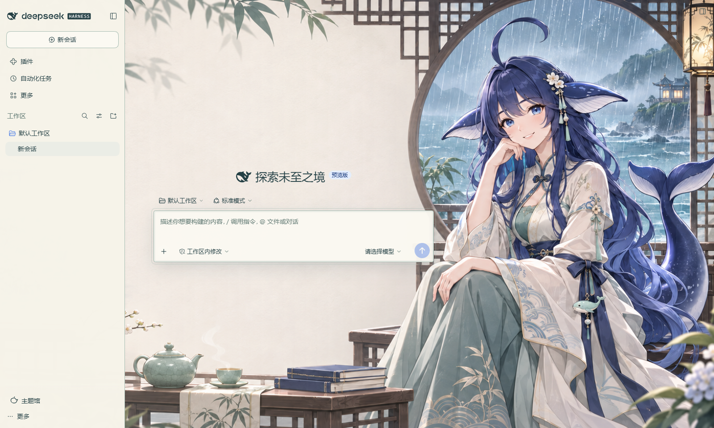
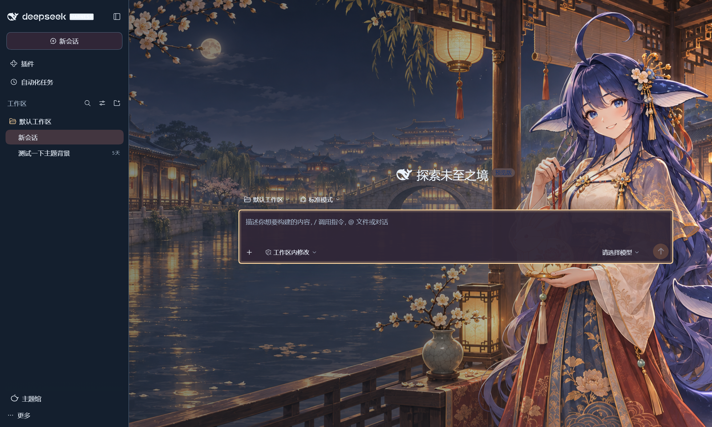

# 鲸鱼娘主题馆 · dsh-whale-gallery

给 [DeepSeek Harness](https://github.com/deepseek-ai) 换皮肤的一个插件：**46 套主题**，点一下即时换，包含标题条、正文、输入卡、按钮、开关、代码块的整套配色，也可以自己加主题。

角色「大肥鱼」为 DeepSeek 拟人化的鲸鱼娘，衍生自社区同人设定；本仓库的插画与代码授权见文末。



## 它长什么样

- **主题馆面板**：侧栏底部「主题馆」或 设置 → 鲸鱼娘主题馆。胶囊按钮切分类（自然 / 古风 / 日式 / 海岸 / 幻想 / 城市），搜索框按名字和关键词找。
- **两个滑块**：「背景浓度」控制插画的存在感，「阅读底色」控制正文背后那层纸色的浓淡（30–100，默认 52）。嫌字压不住就往高拖，嫌画看不清就往低拖。
- **跟随主题的宿主控件**：活动标签、焦点环、主按钮、开关、勾选框都取主题的 `accent`；实心控件会自动压深到白字可读。深色主题里代码块换成深底浅字 + 一套亮色语法高亮。
- **深色 / 浅色都适配**：`tone` 决定界面用的是浅色 token 还是深色 token。



## 安装

需要 DSH **0.2.1-rc.2** 以上、`< 0.2.2-0`。

**桌面端**：设置 → 插件 → 添加插件 → 选本仓库 Releases 里的 `dsh-whale-gallery-*.tgz` → 装完**完全退出** DSH 再打开。

**命令行**：

```bash
dsh plugin --profile <你的 profile> add "/path/to/dsh-whale-gallery-0.1.0.tgz"
```

装好之后侧栏底部多一个「主题馆」按钮；没看到就说明插件没被组合进 profile（检查 `package.json` 的 `dsh.profile.bundles` 里有没有 `dsh-whale-gallery`）。

> 从本地路径安装时，那个 `.tgz` 要一直留着——`file:` 依赖下次启动还会去读它。

## 加到插件市场

DSH 的「插件 → 发现」读的是**索引源 URL**，不是中心仓库。把下面这个地址加进去就能在发现页看到本插件：

```
https://raw.githubusercontent.com/gokyokugenn/dsh-whale-gallery/main/market/index.json
```

索引文件本身在 [`market/index.json`](market/index.json)，格式是 DSH `@deepseek-ai/dsh-plugin-market` 的索引 schema（`schemaVersion` / `title` / `entries[].versions[]`）。

## 自己画一套主题

**不用改代码**：画一张 16:9 的 PNG，填一条配色，跑两条命令。完整规格（构图分区、配色字段、对比度门槛、常见坑）在：

- **[docs/新增主题操作手册.md](docs/新增主题操作手册.md)** ← 从这里开始

一句话版本：

```bash
# 1. 把图放到 art-sources/，在 art-sources.json 加一条 { "id": "...", "path": "art-sources/xxx.png" }
# 2. 在 themes.json 加一条 11 个颜色的元数据
node scripts/check-theme.mjs   # 体检：0 个错误再继续
node scripts/build.mjs         # 出 lib/client.js、assets/manifest.json
```

`check-theme.mjs` 会算对比度、查 PNG 魔数、尺寸比例、id 重复、assets 孤儿，能挡掉大部分「加完不好看」的坑。

## 开发

```bash
pnpm install          # 只装 devDependencies（jsdom / playwright / react）
node scripts/build.mjs
node --test tests/*.test.mjs
npm pack              # 产出可安装的 tgz
```

目录结构：

```
src/          插件源码（client.js 界面 + skin.css 皮肤 + index.js 静态资源路由）
scripts/      build.mjs（打 bundle、算哈希、写 manifest）、check-theme.mjs（自检）
assets/       构建产物：按内容 sha256 命名的插画 + manifest.json
lib/          构建产物：client.js 闭包 bundle、themes.json
docs/         新增主题操作手册
market/       插件市场索引索引文件
```

改 `src/` 之后必须重新 `build.mjs`，装到 profile 的那份 `lib/client.js` 要替换（如果不是软链）。

## 授权

- **代码**：MIT（见 [LICENSE](LICENSE)）。
- **角色与衍生美术**：**CC BY-NC-SA 4.0**（署名 + 非商业使用 + 相同方式共享，见 [LICENSE-ARTWORK](LICENSE-ARTWORK)），因此本仓库的插画不能用于商业用途。
- 署名：角色原作「上善」（pixiv 62155430）；二次设计 ZipZipPipe（pixiv 18604994）；DeepSeek 元素再设计 [Small-tailqwq](https://github.com/Small-tailqwq/dsh-deep-whale)（其参考项目的代码为 MIT）。完整清单见 [NOTICE](NOTICE) 与 [NOTICE-UPSTREAM.txt](NOTICE-UPSTREAM.txt)。

## 致谢

- 皮肤挂载点、`slots` / `layout` 注入方式参考 [dsh-deep-whale](https://github.com/Small-tailqwq/dsh-deep-whale)。
- 主题的每个颜色都按 `ink/paper` 对比度调过，自检脚本的数字口径写在手册的「对比度门槛」一节。
